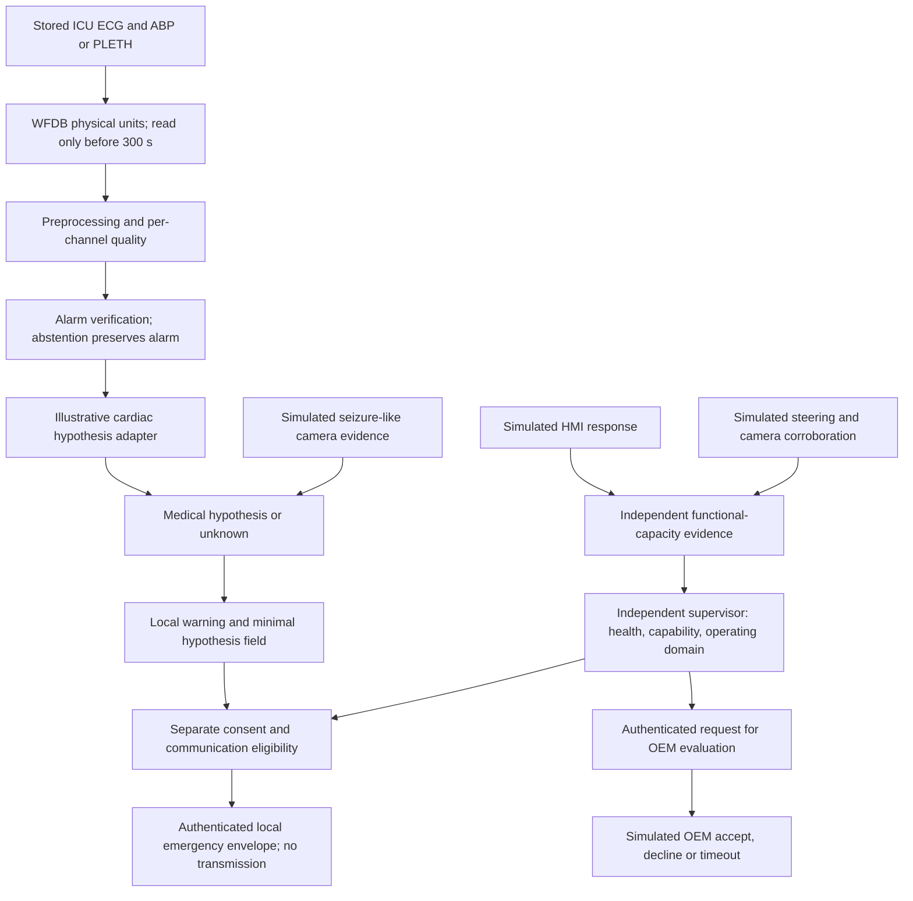

# Architecture and trust boundaries

Only A-D are the measured ICU alarm-verification experiment. Driver-capacity
observations, the seizure branch and OEM behavior remain synthetic. Cardiac false
alarms never establish normal driving. The medical classifier has no actuator
interface. The original normal-driving policy remains available for simulations.
No raw physiology enters the emergency envelope. HMAC provides local authenticity
and integrity, not confidentiality or guaranteed anonymity. No motor command,
V2X stack, real CAN transport or EMS delivery is implemented.
